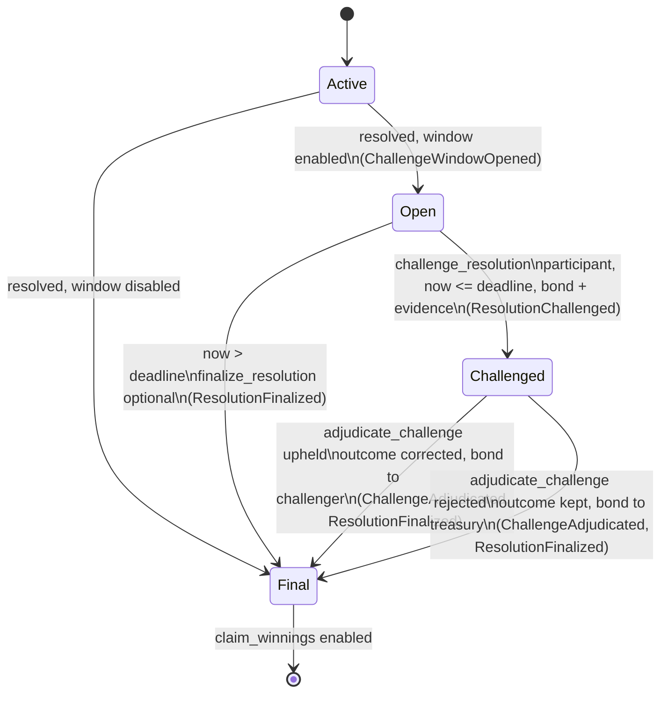

# Resolution Challenge Window

After a pool resolves, PrediFi can hold payouts for a bounded period. During that period, pool participants can challenge the result by posting a bond and evidence. Implementation: `contract/contracts/predifi-contract/src/challenge.rs`.

The window is **disabled by default** (`window_seconds = 0`). With it disabled, a resolution is final immediately, which is how the contract behaved before this feature.

## Policy

| Parameter | Set by | Bounds |
|-----------|--------|--------|
| `window_seconds` | Admin, `set_challenge_config` | `0..=MAX_CHALLENGE_WINDOW` (7 days). `0` disables the window |
| `bond_amount` | Admin, `set_challenge_config` | `> 0` when the window is enabled. Paid in the pool's token |

The policy is copied into the pool's `ResolutionChallenge` record when the pool resolves. A later `set_challenge_config` call never changes a window that is already open.

## Rules

| Concern | Rule |
|---------|------|
| Opening | Every resolution path (`resolve_pool`, `oracle_resolve`, `resolve_pool_from_price`) opens the window. It sets `deadline = resolved_at + window_seconds` |
| Challenger eligibility | Any address holding a prediction in the pool. Only one challenge is accepted per pool |
| Deadline | A challenge can be filed while `now <= deadline`. At `deadline + 1` it fails with `TimeConstraintError` |
| Evidence format | `evidence_hash`: a non-zero `BytesN<32>` commitment (for example SHA-256) to the evidence bundle. `evidence_uri`: where the bundle is stored (for example IPFS), 1–512 bytes. A typical bundle is the signed provider price update for the resolution timestamp |
| Bond | Moved from the challenger to the contract when the challenge is filed |
| Adjudication | Moderator (role 2) only, through `adjudicate_challenge(moderator, pool_id, upheld, corrected_outcome)` |
| Upheld | The pool outcome becomes `corrected_outcome`, which must be valid and different from the original. The bond is refunded to the challenger |
| Rejected | The original outcome stands and the bond goes to the treasury |
| Finalization | Adjudication finalizes immediately. If nobody challenges, the resolution is final once `deadline` passes. `finalize_resolution` (permissionless) records that, and calling it again is a no-op that does not re-emit the event |
| Payouts | `claim_winnings` and `batch_claim_winnings` fail with `TimeConstraintError` while the window is open and with `PoolDisputed` while a challenge is pending. The check runs before the claim is recorded, so a blocked batch claim can be retried later |
| Claim window | Starts when the resolution becomes final: at the deadline if nobody challenged, or at adjudication time if someone did |

## State diagram

`Open`, `Challenged` and `Final` map to `ChallengeStatus::{Open, Challenged, Finalized}`. Pools resolved with the window disabled have no record, and `get_resolution_challenge` returns `None` for them. Throughout all of these states, `Pool.state` stays `Resolved`.

## Errors

| Error | When |
|-------|------|
| `InvalidPoolState` | Pool is not `Resolved`, or `adjudicate_challenge` is called with no pending challenge |
| `TimeConstraintError` | Challenge after the deadline, after finalization, or with no window; claim or finalize before the deadline |
| `PoolDisputed` | Second challenge; claim or finalize while a challenge is pending |
| `Unauthorized` | Challenger has no prediction in the pool; adjudicator is not a Moderator; non-admin sets the policy |
| `InvalidData` | Zero evidence hash, or evidence URI empty or longer than 512 bytes |
| `InvalidOutcome` | Upheld with an out-of-range or unchanged outcome |
| `InvalidTimestamp` / `InvalidAmount` | Policy outside its bounds |

## Read API

- `get_challenge_config() -> ChallengeConfig`
- `get_resolution_challenge(pool_id) -> Option<ResolutionChallenge>`: deadline, bond, status, original outcome, challenger, evidence, `finalized_at`
